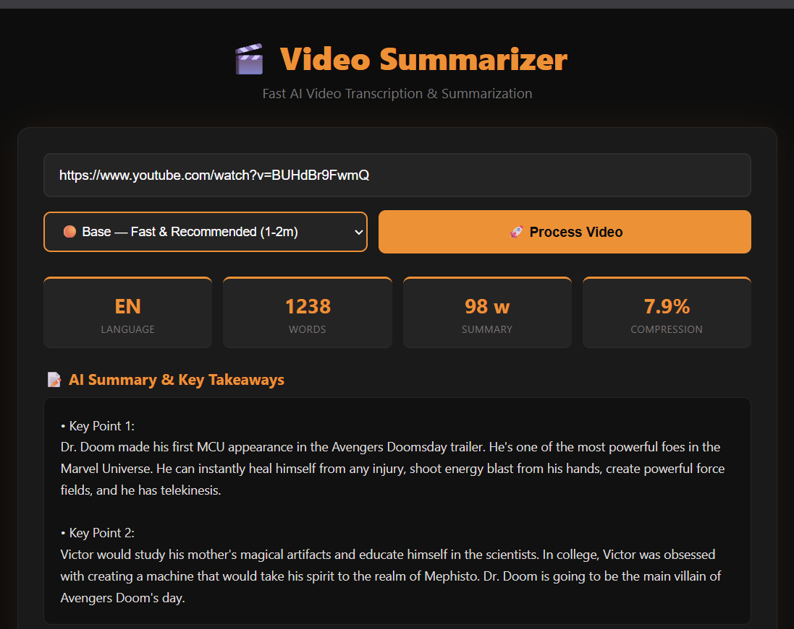
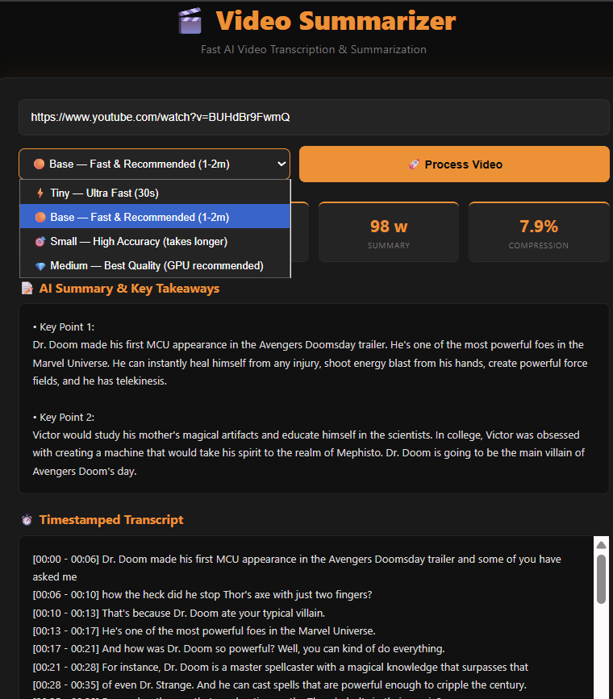

# 🎬 AI Video Summarizer & Timestamped Transcriber

An end-to-end AI application that downloads, transcribes, and summarizes YouTube videos and local video files in real-time. Built with **faster-whisper**, **HuggingFace Transformers (BART)**, and a modern **Dark-Orange themed Web UI**.

---

## 📸 Preview

<div align="center">
  
  <br/><br/>
  
</div>

---

## ✨ Key Features

- ⚡ **Superfast Transcription**: Powered by `faster-whisper` (CTranslate2 int8 quantization) with multi-threaded CPU acceleration.
- 📝 **Abstractive AI Summaries**: Uses `facebook/bart-large-cnn` with token-level chunking to generate concise summaries and key bullet points.
- ⏱️ **Timestamped Transcripts**: Generates exact sentence-by-sentence timestamps (`[02:15 - 02:40]`).
- 🌐 **Modern Web Interface**: Clean Dark-Orange Flask UI with real-time live percentage & stage progress tracking.
- 💾 **Smart Caching**: MD5-based caching instantly loads previously processed videos without re-downloading or re-transcribing.
- 🚀 **Zero-Config Setup**: Automatic FFmpeg detection and configuration via `imageio-ffmpeg`.
- 📁 **Markdown & Text Exports**: Generates `.md` reports and structured text outputs.

---

## 🛠️ Tech Stack

- **Python 3.10+**
- **Speech-to-Text**: `faster-whisper` (OpenAI Whisper on CTranslate2)
- **NLP / Summarization**: Hugging Face `transformers` (BART Large CNN), PyTorch
- **Downloader**: `yt-dlp`
- **Audio Processing**: FFmpeg (`imageio-ffmpeg`)
- **Web App**: Flask, HTML5, CSS3, JavaScript (Async polling)

---

## 🚀 Getting Started

### 1️⃣ Clone & Setup Environment

```bash
# Clone the repository
git clone https://github.com/your-username/video-summarizer.git
cd video-summarizer

# Create a virtual environment
python -m venv .venv

# Activate virtual environment
# On Windows:
.venv\Scripts\activate
# On Linux/macOS:
source .venv/bin/activate

# Install dependencies
pip install -r requirements.txt
```

### 2️⃣ Run the Application

#### Option A: Web UI (Recommended)
Double-click **`Start_Website.bat`** (Windows) or run:
```bash
python server.py
```
Then open [http://127.0.0.1:5000](http://127.0.0.1:5000) in your browser.

#### Option B: Terminal / CLI Mode
```bash
python video_pipeline.py "https://www.youtube.com/watch?v=VIDEO_ID" --whisper-model base
```

#### Option C: Desktop GUI
```bash
python gui.py
```

---

## 📊 Available Whisper Models

| Model | Speed | Quality | Recommended For |
|---|---|---|---|
| **Tiny** | ⚡ Ultra Fast (~30s) | Good | Quick summaries, low-end PCs |
| **Base** | 🟠 Fast (~1-2m) | Great (Recommended) | Balanced performance & accuracy |
| **Small** | 🎯 Medium (~4-8m) | High | Detailed transcripts & complex audio |
| **Medium** | 💎 Slower | Best | High precision / Multi-lingual audio |

---

## 📁 Output Structure

Processed videos are cached and exported to your local output folder:
```
output/
└── <video-hash>/
    ├── report.md         # Formatted Markdown report
    ├── summary.txt       # AI summary & bullet points
    ├── timestamps.txt    # Timestamped transcript
    ├── transcript.txt    # Full raw transcript
    └── metadata.json     # Stats, word counts & cache data
```

---

## 📄 License
MIT License. Feel free to use and customize!
